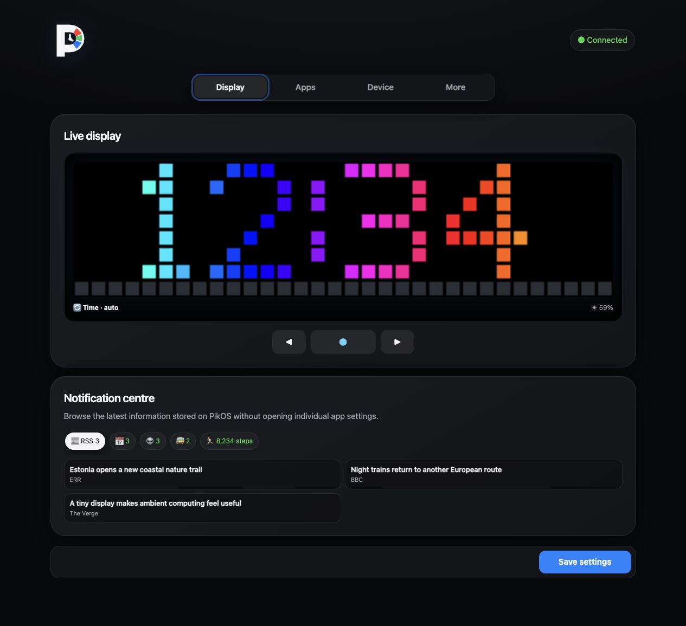
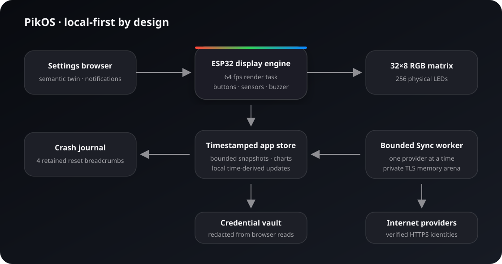

# Ulanzi PikOS

<p align="center">
  
</p>

PikOS is a clean-room, local-first firmware for the ULANZI TC001 32×8 RGB
pixel clock. Its primary job is to run a flexible set of information apps on
the ESP32 itself, with a browser used for configuration, testing, and OTA.

It does not use an external PikOS cloud, telemetry, or a required home
automation server.





## What is implemented

- Clock with NTP synchronization and DS3231 fallback
- Internal SHT3x temperature/humidity app
- Netatmo Weather Station app with OAuth token refresh, indoor/outdoor
  temperature and humidity, wind and rain readings, and dry-to-raining alerts
- Up to six configurable RSS/Atom feeds with automatically fetched,
  locally cached favicon icons and favicon-derived text colours
- Keyless Yahoo stock quotes, Frankfurter daily forex reference rates, and
  Kraken Bitcoin OHLC data, with optional Twelve Data
- Elering day-ahead energy prices with low/average/high daily bands, VAT,
  and a countdown to the next meaningful price-band change
- Add/remove named calendars from private read-only iCal addresses, each with
  its own icon, merged by start time with compact days/hours/minutes countdowns
  and alerts for exported reminders
- Up to 12 background alarms plus an interactive Counter app that works as a
  stopwatch or countdown timer without depending on Wi-Fi
- Experimental, account-free Tallinn stop departures with up to 16 saved
  stop/line/icon combinations, two cached departures each, and local countdowns
- Add/remove account-free Reddit top-post feeds with an icon per subreddit
- Two-stage market views with text followed by continuous 23×7 charts:
  selectable Yahoo history and Elering time windows beside the selected icon
- Add/remove multi-zone clocks with searchable IANA-style city presets,
  daylight-saving rules, half-hour offsets, and an icon for each timezone
- Static, ticker, split-flap, slide, rainbow, pixel-rain, and nearest-position
  “magic move” animation per local app; icons participate in each transition
- Mixed-case Estonian-capable pixel font and word-aware animation pages
- Per-state and per-item selection from the LaMetric 8×8 icon gallery,
  including animated icons, weather/energy/battery variants, timezone,
  RSS-feed and ticker pairings, an offline cache, and built-in fallbacks
- Estonian and English device/web-interface text
- Automatic hue-stable LDR brightness with configurable calibration, gamma,
  limits, and temporal dithering
- Filtered battery estimation with a persistent observed ADC profile, a
  five-level vertical gauge, optional low-battery brightness saver, and an
  option to add the Battery app to the rotation only when charge is low
- Manual brightness override and 180° display orientation
- Deterministic semantic and favicon-derived colours
- Scheduled or idle sleep, button wake, display-off and fixed-minimum-brightness
  StandBy clock modes, app durations, and message limits
- Fair automatic rotation with persistent per-app cursors, so timezones,
  headlines, tickers, events, and posts resume where they left off
- A visible two-tier synchronization app every 1, 5, or 10 slideshow loops:
  one bounded provider queue refreshes stored snapshots and lightweight app
  logic derives the current electricity/calendar state from timestamps
- A single, paced 64 fps render path on its own task, with button sampling
  isolated from web, Wi-Fi, TLS, and sensor work
- Selectable per-app feature tones, six assignable custom RTTTL tune slots,
  a simple volume slider, and measured low-volume note compensation
- Browser-based settings with native light/dark appearance, visual animation
  choices, one auditionable named sound library, a main-page notification
  centre with a chronological all-app feed and app filters, a full-height
  horizontal app carousel, per-app storage health, a
  compressed 32×8 digital twin, on-screen button remote control,
  browser-rendered motion, realistic pixel borders, and OTA
- Sync-provider circuit breakers, a persistent four-entry panic journal, and
  a 128 KiB core-dump partition for post-crash source-level diagnosis
- Optional LAN notification and pixel-frame ingestion protected by a generated
  API key; experimental remote-display protocols are not exposed in the normal UI

The verified TC001 hardware map is:

| Function | GPIO |
|---|---:|
| 256-pixel WS2812B matrix | 32 |
| Left / middle / right buttons | 26 / 27 / 14 |
| Buzzer | 15 |
| Battery ADC | 34 |
| Light ADC | 35 |
| I²C SDA / SCL | 21 / 22 |
| SHT3x / DS3231 | `0x44` / `0x68` |

The map agrees with the existing AWTRIX 3 hardware documentation and the
[Tasmota TC001 template](https://templates.blakadder.com/ulanzi_TC001.html).

## Build

Install [PlatformIO](https://platformio.org/), then:

```sh
pio run
```

The resulting image is `.pio/build/tc001/firmware.bin`. The current RC build
occupies about four fifths of the 1.8125 MiB OTA slot. The partition table also
reserves 128 KiB for crash dumps without moving or shrinking the settings/icon
SPIFFS partition.

The packaged release contains:

- `dist/ulanzi-pikos-0.22.0-rc7-full.bin` — bootloader, partition table, and
  firmware merged for the first serial installation at address `0x0`;
- `dist/ulanzi-pikos-0.22.0-rc7-ota.bin` — application-only image for PikOS's
  browser updater; and
- `dist/SHA256SUMS` — integrity hashes for both images.

Before replacing the factory firmware, make a backup. With the clock switched
on and connected through a USB-C **data** cable:

```sh
esptool.py --port /dev/your-port read_flash 0x0 0x400000 tc001-factory.bin
```

Then flash PikOS:

```sh
pio run --target upload --upload-port /dev/your-port
```

Or install the packaged full image without PlatformIO:

```sh
esptool.py --chip esp32 --port /dev/your-port write_flash 0x0 \
  dist/ulanzi-pikos-0.22.0-rc7-full.bin
```

For animation performance testing, PikOS exposes the compact
`/api/v1/performance` endpoint. The included monitor checks effective render
FPS, missed 16.67 ms deadlines, worst frame gap, and LED transmission time:

```sh
python3 tools/monitor_framerate.py pikos.local --seconds 60
python3 tools/monitor_framerate.py pikos.local --seconds 60 --stress-ui
python3 tools/monitor_visual_integrity.py pikos.local --app rss --seconds 30
python3 tools/monitor_button_latency.py pikos.local --mode api --stress-page
python3 tools/stress_sync.py pikos.local --cycles 5
```

To restore a full 4 MB backup later:

```sh
esptool.py --port /dev/your-port write_flash 0x0 tc001-factory.bin
```

Keep the backup private: it can contain saved Wi‑Fi credentials and other
factory settings. A full-flash restore replaces PikOS, its settings, and its
partition table.

The TC001 includes a CH340 USB/serial bridge. A CH340 driver may be needed on
older operating systems. Do not disconnect power while erasing or flashing.

## First boot

1. PikOS first tries the saved Wi‑Fi network.
2. Without credentials, or after a 15-second connection failure, it creates
   `PikOS-XXXXXX`.
3. Read the unique `PASS …` value scrolling on the matrix and use it to join
   the setup network.
4. Open `http://192.168.4.1/`.
5. Enter Wi‑Fi credentials, choose English or Estonian, and save.
6. On the home network, use the IP shown by a long middle-button press or in
   the browser status pane.

Secret fields are returned blank by the settings API. A blank secret field
means “keep the stored value.” Wi-Fi, Netatmo, and market credentials are
stored in small dedicated NVS entries rather than inside the larger rotating
settings document, so an unrelated configuration rollback cannot silently
erase them. The status API also reports a numeric Wi-Fi disconnect reason and
a human-readable diagnosis.

## Buttons

| Action | Result |
|---|---|
| Left / right press | Previous / next app and enter sticky manual mode |
| Middle press | Advance once and resume automatic rotation |
| Middle long press | Show Wi‑Fi/AP address |
| Left long press | Queue a refresh of all enabled online apps |
| Any button during sleep | Wake for the configured interval |

Left and right swap automatically when 180° orientation is enabled.

## Local apps

Each app can be enabled independently and assigned `static`, `ticker`, `flip`,
`slide`, `rainbow`, `rain`, or `magic` animation. Split-flap and static layouts
paginate on word boundaries. Rain drops the old pixels away individually and
lets the next page fall in; magic pairs new pixels with the nearest old pixel
and moves them into place. Automatic rotation gives every app the same
configured time budget, then finishes the active page before changing apps;
in sticky manual mode, multi-item apps continue indefinitely.
Online sources refresh in a dedicated Sync app after the selected number of
complete slideshow loops. Its small serialized jobs keep TLS and parser memory
bounded on the ESP32 while the Earth, red bidirectional signal, satellite, and
provider progress bar make the pause explicit. Between syncs, energy prices,
chart position, price band, calendar countdowns, and alarms are derived from
the stored timestamped data without network work. A newly detected top headline is shown
immediately and can play its selected tone. With the ticker animation, the
feed icon travels with the headline so the full 32-pixel width becomes
available after it leaves the display.

Magic Move preserves matching characters as whole glyphs between pages, then
moves only the remaining unmatched pixels to their nearest new positions.
Large prices compact only when necessary: currencies stay in front, so
`52673 USD` becomes `$53K`, while the narrow numeric font lets `$8,5K` fit.
The otherwise unused bottom row is a mode indicator: a subtle grey timeline
means automatic rotation; in manual mode, the full 32-pixel width is divided
continuously between enabled apps and the brighter segment marks the pinned
app. During Sync, progress advances pixel by pixel using learned provider
timings instead of jumping once per provider.

The energy app reads official
[Elering day-ahead prices](https://dashboard.elering.ee/assets/swagger-ui/index.html),
converts EUR/MWh to cents/kWh, optionally adds VAT, and divides each local day
into low, average, and high price thirds. The compact view shows the current
price, communicates its band with the icon and colour, then shows the selected
today, next-12-hour, next-24-hour, or today-and-tomorrow chart. Every graph
segment uses the same daily price-band thresholds: green is cheap, yellow is
average, and red is expensive.

The settings page searches the
[LaMetric icon gallery](https://developer.lametric.com/icons) and assigns one
icon ID inside each app card. The selected climate provider has low/medium/high
temperature and humidity icons; markets pair each ticker with its own icon; and
energy has low/average/high icons. PikOS downloads selected 8×8 frame data in
the background and caches a
compact copy in SPIFFS. For RSS, an ID of `0` fetches the feed favicon at
runtime; for markets it generates a compact ticker/currency badge; other
zero-ID fields select their built-in fallback. RSS text colour follows the
cached feed icon's dominant saturated colour; temperature, market, battery,
energy, and clock text keep predictable semantic colours.

The buzzer accepts standard monophonic RTTTL strings in six configurable
slots. Each slot can be selected independently for RSS, energy changes,
hourly, remote notification, and button events, and tested from the browser
before saving. PWM duty controls volume. The bundled 99% pitch calibration and
volume-aware high-note equalization were measured from the TC001 with a
Sennheiser Profile microphone so changing the single volume slider changes
loudness without reshaping the tune as much.

The single desktop setup helper handles both supported account flows:

```sh
python3 tools/pikos_credentials.py netatmo
python3 tools/pikos_credentials.py garmin
```

It prompts for secrets locally, writes no token store, emits copyable settings
JSON, and never prints passwords, MFA codes, authorization codes, or
short-lived access tokens. The JSON contains the persistent credentials PikOS
needs, so clear the terminal after pasting it into the matching app card.

For Netatmo setup, see [docs/NETATMO.md](docs/NETATMO.md). Market setup is in
[docs/MARKETS.md](docs/MARKETS.md), and energy-price behavior is in
[docs/ENERGY.md](docs/ENERGY.md). The experimental free Garmin Connect route is in
[docs/garmin-connect-activity.md](docs/garmin-connect-activity.md), while the
experimental Tallinn departures contract and future routing choices are in
[docs/travel-app.md](docs/travel-app.md).
The optional LAN API is documented in [docs/API.md](docs/API.md).

## Security and current hardware status

- Provider HTTPS connections authenticate server certificates against an
  embedded 122-root public CA bundle. Browser reads never return Wi‑Fi,
  Netatmo, Garmin, calendar, market, or remote API credentials.
- Settings, controls, sound tests, restart, and OTA require an HttpOnly
  per-boot browser session plus explicit same-origin intent. Remote
  notifications and raw frames use a separate constant-time API-key check.
- The portal remains a trusted-LAN appliance without a user login, and local
  browser traffic is plain HTTP. Do not expose port 80 to the internet; use a
  trusted network or isolated IoT VLAN. Physical flash access can still reveal
  NVS credentials because stock TC001 hardware does not provide PikOS with
  secure boot or flash encryption.
- Release checks include 52 automated contracts, an ESP32 build, secret scan,
  browser interaction/overflow checks, and hardware FPS/button/sync monitors.
- PikOS has been flashed and exercised on the target TC001. Each release
  image is still a test build until its display behavior and online services
  have been checked on the physical clock.

See [SECURITY.md](SECURITY.md) for the trust model and reporting process.

## Project layout

```text
include/          Public firmware modules and embedded web UI
src/              Firmware implementation
scripts/          Deterministic embedded-asset generators
tools/            Unified account setup and LAN diagnostic helpers
docs/             Integration and API guides
platformio.ini    Reproducible ESP32 build
partitions.csv    Dual 1.875 MB OTA slots
```

## License

MIT. See [LICENSE](LICENSE).
